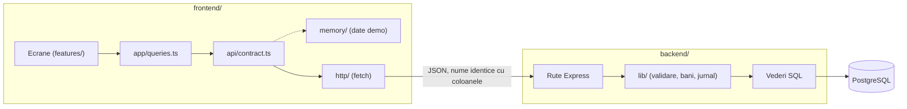

# Gestiune Clinică

Aplicație internă de gestiune a clienților unei clinici de înfrumusețare:
programări, fișe de client, încasări, nomenclator, conturi și jurnal de
operațiuni.

Contract **CTR-2026-011** (TZ INTELLIGENCE 28 SRL — S.C. ZIAN BUILDING S.R.L.).

Depozitul ține **ambele componente**, ca să nu se despartă niciodată versiunea
interfeței de versiunea serverului cu care vorbește:

| Dosar | Ce este | Tehnologii |
| --- | --- | --- |
| [`frontend/`](frontend) | aplicația (Windows, Android, iOS, dintr-o singură bază de cod) | Tauri 2 · React 19 · TypeScript · Tailwind 4 |
| [`backend/`](backend) | serverul și schema bazei de date | Node · Express · PostgreSQL 16, fără ORM |

Fiecare dosar are README-ul lui, cu detaliile care contează acolo:
[interfața](frontend/README.md) · [serverul](backend/README.md).

---

## Cum stau lucrurile împreună



Două reguli țin arhitectura dreaptă, iar restul decurge din ele:

**Componentele nu importă niciodată `api` direct.** Tot ce se citește și se
scrie trece prin `frontend/src/app/queries.ts`, singurul loc unde stau și
invalidările memoriei cache.

**Nu există strat de traducere.** Numele câmpurilor din JSON sunt identice cu
numele coloanelor din PostgreSQL (`incepe_la`, `punct_lucru_id`, `arhivat_la`).
Ce scrie în `backend/sql/01_schema.sql` este exact ce citește ecranul.

Granița dintre cele două este o singură interfață TypeScript,
[`frontend/src/api/contract.ts`](frontend/src/api/contract.ts), cu două
implementări. Fără `VITE_API_URL`, aplicația rulează pe date demonstrative în
memorie și nu are nevoie de server; cu ea, vorbește cu serverul real. Comutarea
nu cere nicio modificare de cod.

---

## Pornire

Ai nevoie de **Node 20+**, **PostgreSQL 14+** și, doar pentru pachetele native,
de **Rust**.

```bash
# 1. Serverul
cd backend
npm install
cp .env.example .env           # completează DATABASE_URL și JWT_SECRET
createdb clinica
psql -d clinica -f sql/01_schema.sql
npm run seed                   # conturi, nomenclator, un istoric scurt
PORT=3001 npm run dev

# 2. Interfața, în alt terminal
cd frontend
npm install
cp .env.example .env.local     # VITE_API_URL=http://localhost:3001
npm run dev                    # http://localhost:1420
```

Sari peste pasul 1 dacă vrei doar să vezi aplicația: fără `.env.local`, pornește
singură, pe date demonstrative.

Conturile scrise de `seed` sunt aceleași ca în modul demo, ca trecerea de la
unul la altul să nu ceară altă parolă. Toate au parola `parola123`:

| E-mail | Rol |
| --- | --- |
| `admin@clinica.ro` | administrator |
| `andreea.popescu@clinica.ro` | utilizator |
| `diana.georgescu@clinica.ro` | utilizator (cont dezactivat) |

> **Schimbă parolele înainte de a pune serverul în folosință.** Sunt parole de
> demonstrație, scrise în cod și publicate aici.

---

## Verificarea

```bash
cd frontend && npm test          # 184 de teste: interfață, reguli, formulare
cd frontend && npm run typecheck
cd backend  && npm run test:db   # „văd baza? are schema și constrângerile?”
cd backend  && npm run test:api  # 130 de verificări, întreg contractul HTTP
```

Iar legătura dintre ele, cu serverul pornit:

```bash
cd frontend && API_LIVE=http://localhost:3001 npx vitest run src/api/http
```

Acesta rulează clientul HTTP **pe care îl folosește chiar aplicația** împotriva
serverului real. Ambele teste scriu date adevărate: se folosesc pe baza de
dezvoltare, niciodată pe cea a clinicii.

---

## Compilare

| Platformă | Comandă (din `frontend/`) |
| --- | --- |
| Windows | `npm run tauri:build` |
| Android | `npm run tauri:android` |
| iOS | `npm run tauri:ios` |

Serverul se compilează cu `npm run build` și rulează din `dist/` cu `npm start`.

---

## Ce nu se urcă în depozit

`.env`, `.env.local`, `node_modules/`, `dist/` și `src-tauri/target/` sunt
excluse. Secretele — `DATABASE_URL`, `JWT_SECRET` — stau **numai** local, iar
`parola_hash` nu părăsește niciodată serverul. Șabloanele sunt în
`backend/.env.example` și `frontend/.env.example`.

---

## Date privind sănătatea

Notele libere de pe fișa clientului pot conține, dacă Beneficiarul alege astfel,
date din categoriile speciale prevăzute de **art. 9 GDPR** (art. 8.3 din
Contract). Aplicația **nu este dispozitiv medical** și nu oferă diagnostic sau
recomandare terapeutică (art. 8.4).
