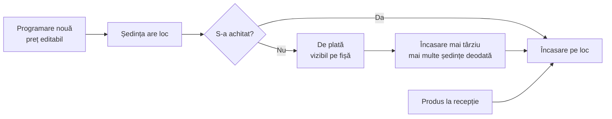
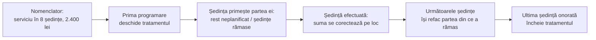

# Gestiune Clinică — aplicația client

Aplicație internă de gestiune a clienților unei clinici de înfrumusețare.
Contract **CTR-2026-011** (TZ INTELLIGENCE 28 SRL — S.C. ZIAN BUILDING S.R.L.).

Acest dosar conține **componenta client** (art. 2.1 „Aplicația (client)”).
Serverul și schema PostgreSQL stau alături, în [`../backend`](../backend).

---

## Stare actuală

Interfața este completă și funcțională. Rulează în două moduri, alese dintr-o
singură variabilă de mediu:

- **fără `VITE_API_URL`** — date demonstrative ținute în memorie. Nu are nevoie
  de nimic instalat, iar modificările se pierd la închidere. Ecranul afișează
  permanent o panglică de avertizare cât timp acest mod este activ.
- **cu `VITE_API_URL`** — serverul real, cu PostgreSQL în spate. Vezi
  [Conectarea la backend](#conectarea-la-backend).

Trecerea de la unul la altul nu cere nicio modificare de cod.

---

## Platforme

Conform art. 2.1 și 2.2, dintr-o singură bază de cod:

| Platformă | Comandă                 |
| --------- | ----------------------- |
| Windows   | `npm run tauri:build`   |
| Android   | `npm run tauri:android` |
| iOS       | `npm run tauri:ios`     |

Aspectul se adaptează dimensiunii ecranului: pe desktop, bară laterală și grile
de calendar cu coloane; pe telefon, bară de navigație jos, liste în locul
tabelelor și ferestre ancorate la marginea de jos. Diferențele acestea sunt cele
prevăzute la art. 2.2 și nu constituie neconformitate.

Aplicația este scrisă pentru **o singură locație**. Punctul de lucru nu se
alege și nu se administrează nicăieri în interfață; vezi
[Abateri de la §3](#abateri-de-la-3-cerute-de-beneficiar).

---

## Tehnologii

Componentele principale sunt cele convenite la art. 2.1 și nu se pot schimba
decât cu acordul scris al Părților (art. 2.3):

- **Tauri 2** — împachetare nativă pentru cele trei platforme
- **React 19** + **TypeScript** — interfața
- **Tailwind CSS 4** — stilizarea

Bibliotecile auxiliare rămân la alegerea Prestatorului (art. 2.3): Vite,
TanStack Query, React Router, date-fns, lucide-react, Vitest.

> **Notă.** Interfața este realizată în React, nu în React Native. Cele două nu
> se combină: Tauri randează într-un webview, React Native randează în
> componente native. Varianta din contract este cea implementată.

---

## Pornire

Sistemul are nevoie de Node.js 20+ și de Rust (doar pentru pachetele native).

```bash
npm install          # dependențe
npm run dev          # interfața în browser, pe http://localhost:1420
npm run tauri:dev    # aplicația nativă, cu fereastră proprie
npm test             # suita de teste
npm run typecheck    # verificarea tipurilor
```

### Conturi demonstrative

Toate au parola `parola123`:

| E-mail                         | Rol           | Observație                        |
| ------------------------------ | ------------- | --------------------------------- |
| `admin@clinica.ro`             | administrator | acces complet                     |
| `andreea.popescu@clinica.ro`   | utilizator    | acces de operare                  |
| `diana.georgescu@clinica.ro`   | utilizator    | cont dezactivat — nu se conectează |

---

## Cum circulă banii

Serviciile se încasează **prin programare**, produsele **prin încasare**. Nu
există a doua cale pentru niciunul: un serviciu nu se vinde manual, iar un
produs nu se programează.



Prețul unei ședințe se propune singur: dacă acelui client i s-a mai făcut acel
serviciu, revine prețul lui; altfel, prețul de listă. Rămâne editabil, iar
suma tastată devine automat prețul lui pentru data viitoare. La închiderea
ședinței („Ședință efectuată”) suma se mai poate corecta o dată — cât s-a luat
de fapt — înainte de a intra în încasare.

În cod, secțiunea se numește în continuare `vanzari` — tabelele și rutele §7
nu s-au schimbat. Doar ecranul spune „Încasări”, pentru că asta este.

## Tratamente — serviciile în mai multe ședințe

„Epilare IPL axile, 6 ședințe”, „anti-acnee, 4 ședințe”: serviciul se cumpără
o dată și se face în mai multe veniri. În Nomenclator, serviciul primește un
**număr de ședințe**; peste 1, prețul de listă este al întregului tratament.

Prima programare a unui asemenea serviciu **deschide singură un tratament** pe
fișa clientului. Următoarele ședințe intră în el — din calendar, ca oricare
programare, sau din fila **Tratamente**, cu butonul „Programează”, unde
clientul și serviciul sunt deja alese. Formularul spune dinainte ce urmează să
facă: „Ședința 3 din 8 a tratamentului în curs”.



Banii nu au un al doilea drum. Prețul total se **împarte pe ședințe** la
programarea fiecăreia — restul neplanificat, la ședințele rămase — și devine
prețul ședinței, care se încasează exact ca orice altă ședință. Dacă la o
ședință s-a luat mai mult sau mai puțin, următoarele își refac singure partea.
Ecranul „Tratamente” arată, pentru fiecare client, câte ședințe s-au făcut din
câte, cât s-a încasat din cât, când e următoarea — și îi pune primii pe cei
fără nicio ședință programată, adică pe cei de sunat.

Nimic din toate acestea nu este un contor ținut de mână: tabela `tratament`
ține doar înțelegerea (câte ședințe, cât în total), iar restul se numără din
programări la fiecare citire. Rutele sunt `/tratamente`; o ședință anulată sau
o neprezentare nu ocupă un loc din cele convenite.

## Ce mai încape în calendar

**Notițe.** „Irina e în concediu”, „vine furnizorul la 15:00”: o însemnare cu
titlu, interval și, opțional, o persoană — fără client, fără serviciu, fără
preț. Stă în calendar lângă programări, pe fundal gălbui cu contur întrerupt,
ca să nu fie luată drept ședință. Nu blochează intervalul (o notiță peste o
programare nu e o greșeală, e informația) și e singurul lucru din calendar care
se poate șterge, cu urmă în jurnal. Butonul „Notiță” stă lângă „Programare
nouă”; tabela e `notita`, rutele `/notite`.

**Clientul și serviciul pe loc.** Din formularul de programare, numele tastat
în căutare care nu găsește nimic devine rândul „Client nou: „…””. O apăsare —
sau Enter — creează fișa doar cu numele și o lasă aleasă; telefonul și restul
se completează pe fișă, când e timp. Același drum pentru un serviciu care nu e
încă în nomenclator (durată 60 min și preț de listă zero, de corectat în
Nomenclator) — dar acela cere administrator, fiindcă `POST /articole` îi este
rezervat (§7). Prețul ședinței se scrie oricum pe programare, deci recepția nu
rămâne blocată.

## Conectarea la backend

Întreaga interfață comunică printr-o singură interfață TypeScript,
[`src/api/contract.ts`](src/api/contract.ts). Ea are două implementări:

| Implementare        | Fișier                    | Când se folosește          |
| ------------------- | ------------------------- | -------------------------- |
| date în memorie     | `src/api/memory/client.ts` | implicit, fără configurare |
| apeluri HTTP reale  | `src/api/http/client.ts`   | când există `VITE_API_URL` |

Comutarea se face dintr-o singură variabilă de mediu:

```bash
# .env.local
VITE_API_URL=http://localhost:3001
```

Nicio componentă nu se modifică. Implementarea HTTP este scrisă integral și
tratează deja antetul `Authorization`, reînnoirea token-ului la 401 și
transformarea codurilor de eroare.

### Serverul

Codul serverului este în [`../backend`](../backend) — Node + Express +
PostgreSQL, cu schema în `sql/01_schema.sql`. Pornire:

```bash
cd ../backend
npm install
createdb clinica && psql -d clinica -f sql/01_schema.sql
npm run seed                  # conturi, nomenclator, un istoric scurt
PORT=3001 npm run dev
```

Conturile scrise de `seed` sunt aceleași ca în modul demo (`admin@clinica.ro` /
`parola123`), ca trecerea de la unul la altul să nu ceară altă parolă.

### Verificarea legăturii

```bash
API_LIVE=http://localhost:3001 npx vitest run src/api/http
```

Rulează clientul HTTP **pe care îl folosește chiar aplicația** împotriva
serverului pornit: autentificare, listă paginată, programare → onorare →
încasare, prețul reținut, istoric, traducerea erorilor. Fără `API_LIVE`, testul
se sare, iar restul suitei rămâne pe datele din memorie.

Testul scrie date adevărate. Se folosește pe baza de dezvoltare, niciodată pe
cea a clinicii.

### Ce trebuie să respecte serverul

`src/api/contract.ts` documentează, pentru fiecare metodă, **ruta HTTP și rolul
necesar**, exact ca în §7 al specificației tehnice. Serverul este compatibil
dacă respectă acele rute și formele din `src/domain/types.ts`.

Numele câmpurilor din JSON sunt **identice** cu numele coloanelor din
PostgreSQL (`incepe_la`, `punct_lucru_id`, `arhivat_la`…). Nu există strat de
traducere: ce trimite serverul, aceea consumă interfața.

Convenții așteptate:

- `timestamptz` → șir ISO 8601 în UTC (`2026-09-07T14:30:00.000Z`)
- `date` → `YYYY-MM-DD`
- `numeric(p,s)` → număr
- coloanele nule → `null` explicit, nu câmp absent
- erorile → cod HTTP corespunzător, cu corp `{ "mesaj": "...", "camp": "..." }`;
  `camp` leagă mesajul de câmpul de formular vinovat

Rute în plus față de §7, folosite de interfață:

- `POST /clienti/:id/dezarhivare` — operațiunea inversă arhivării
- `GET /auth/eu` — utilizatorul din spatele token-ului curent
- `GET /programari/pret-sugerat?client_id=&articol_id=` — prețul cu care se
  deschide formularul de programare
- `POST /vanzari/incasare` — stinge într-o singură plată mai multe ședințe

### Abateri de la §3, cerute de Beneficiar

Modificări de schemă convenite după demonstrații. Sunt puține și aditive:
nicio coloană existentă nu își schimbă înțelesul.

| Modificare | Unde | De ce |
| --- | --- | --- |
| `programare.pret numeric(10,2) NOT NULL` | tabela `programare` | Fiecare ședință are prețul ei, convenit la programare și editabil acolo. Prețul din nomenclator rămâne doar referință. |
| `vanzare_linie.programare_id uuid NULL REFERENCES programare(id)` | tabela `vanzare_linie` | Leagă plata de ședința pe care o stinge. Pe LINIE, nu pe antet, ca o singură încasare să poată acoperi mai multe ședințe. |
| `punct_lucru` nu mai apare în interfață | — | Clinica are o singură locație. Coloanele și rutele rămân neatinse; serverul completează punctul implicit când cererea nu îl trimite. |
| tabela `notita` | nouă | Însemnări în calendar care nu sunt programări. |
| `articol.numar_sedinte`, tabela `tratament`, `programare.tratament_id` | nomenclator + nouă + `programare` | Serviciile în mai multe ședințe: înțelegerea (câte, cât) stă în `tratament`; ședințele o referă. Tot ce se vede în ecranul „Tratamente” se numără din programări (`v_tratament_detaliu`). |
| `vanzare.achitat_la timestamptz NULL` | tabela `vanzare` | Produse date acum, plătite mai târziu: NULL = neachitată, suma intră în `de_incasat`. Se bifează „Achitat” / „Neachitat” din formular, din detaliul vânzării și de pe fișă. O vânzare care stinge ședințe nu poate rămâne neachitată. |

Din a doua modificare rezultă două câmpuri **derivate**, pe care serverul le
calculează și interfața doar le citește — nu există coloană `achitat`, pentru
că două locuri pentru același adevăr ajung să se contrazică:

- `ProgramareDetaliu.achitat` — `EXISTS (SELECT 1 FROM vanzare_linie WHERE programare_id = programare.id)`
- `ProgramareDetaliu.achitat_la` — `efectuat_la` al încasării care a stins-o
- `ClientListItem.de_incasat` — suma `pret` a ședințelor onorate fără linie de încasare, plus totalul vânzărilor de produse neachitate
- `VanzareDetaliu.achitat` — `achitat_la IS NOT NULL`

Coloana `vanzare.programare_id` din §3 rămâne neatinsă, dar **nu este citită de
interfață** și se scrie `NULL`. Într-un antet încape o singură ședință, iar o
plată stinge de regulă mai multe; legătura reală este cea de pe linie.

### Fișa nu repetă ce s-a întâmplat o dată

`GET /clienti/:id/istoric` întoarce tot — și programări, și încasări. Fișa le
compune însă în funcție de ce răspund: o încasare care doar stinge ședințe nu
apare deloc (ședința e deja în cronologie, cu preț, cu „Achitat” și cu data
plății), iar una cu produse apare redusă la liniile de produs. Altfel aceeași
ședință s-ar fi citit de două ori, iar coloana de sume ar fi dat dublul realității.

Pe ecranul **Încasări** bonul rămâne întreg: acolo se citesc banii, și un bon
fără ședințele pe care le-a stins ar fi un bon fals.

Prețul „ținut minte” pentru un client **nu** este o tabelă nouă: este prețul
ultimei lui ședințe la acel serviciu, ignorând ședințele anulate. O tabelă în
plus ar fi trebuit ținută în sincron cu programările și ar fi rămas în urmă.

### Regulile bazei sunt deja aplicate în interfață

Implementarea în memorie nu este un simulacru permisiv: reproduce
constrângerile din §8, ca formularele să fie construite împotriva regulilor
reale, nu ale unei imitații mai îngăduitoare.

- `programare_fara_suprapunere` — aceeași persoană nu poate avea două
  programări suprapuse; cele anulate eliberează intervalul
- `articol_durata_ck` — serviciile au durată, produsele nu
- `ON DELETE RESTRICT` — un client cu programări sau vânzări nu se șterge
- `vanzare_linie.total_linie` — `round(cantitate × pret_unitar, 2)`, cu
  aceeași rotunjire ca PostgreSQL
- `jurnal_operatiuni` — append-only, cu doar câmpurile modificate

Regulile noi ale plății, la fel de obligatorii pe server:

- o ședință nu se poate încasa de două ori (409)
- se încasează doar ședințele **onorate** — nu cele programate sau anulate
- nu se poate încasa ședința altui client
- prețul unei ședințe deja încasate nu se mai modifică
- sumele încasării vin din `programare.pret`, **niciodată** din corpul cererii:
  altfel interfața ar putea încasa altceva decât s-a convenit

Toate sunt acoperite de teste în `src/api/memory/client.test.ts`.

---

## Structura

```
src/
├── domain/       tipurile entităților, identice cu schema bazei
├── api/
│   ├── contract.ts   ← interfața API; SINGURA graniță cu serverul
│   ├── memory/       implementarea pe date în memorie, cu constrângeri
│   ├── http/         implementarea pe fetch
│   └── session.ts    token-urile de acces și de reînnoire
├── app/          autentificare, temă, navigație, stratul de interogări
├── ui/           trusa de componente reutilizabile
├── components/   piese comune de aplicație (cadru, selectoare, însemne)
├── features/     ecranele, pe module
│   ├── auth/         autentificare
│   ├── programari/   calendar zi / săptămână / lună + agendă, preț și plată
│   ├── clienti/      listă, fișă, note, istoric, încasarea restanțelor
│   ├── tratamente/   serviciile în mai multe ședințe: progres, bani, programare
│   ├── vanzari/      încasările (ruta /incasari): plăți și produse
│   ├── nomenclator/  servicii și produse
│   ├── utilizatori/  conturi și roluri
│   └── jurnal/       jurnalul operațiunilor
└── lib/          utilitare: date, bani, text, formulare
```

Regula de arhitectură: **componentele nu importă niciodată `api` direct**.
Citirile și scrierile trec prin `src/app/queries.ts`, unde stau și invalidările
memoriei cache. Astfel, o vânzare nouă împrospătează într-un singur loc lista de
vânzări, istoricul clientului, contoarele din lista de clienți și jurnalul.

---

## Ce NU face aplicația

Potrivit art. 4, nu fac obiectul Contractului și nu sunt implementate:
programarea online de către clienții finali, plățile și procesatoarele de plată,
ANAF / RO e-Factura și casa de marcat, integrările contabile, notificările
automate către clienți, gestiunea stocurilor și a salariilor, dosarul medical
electronic, rapoartele analitice dincolo de listele filtrabile, funcționarea
fără conexiune la internet, versiunile macOS/Linux și cea din browser, precum și
importul de date dintr-un sistem existent.

Aplicația **nu este dispozitiv medical** și nu oferă diagnostic sau recomandare
terapeutică (art. 8.4).

### Date privind sănătatea

Notele libere de pe fișa clientului pot conține, dacă Beneficiarul alege astfel,
date din categoriile speciale prevăzute de art. 9 GDPR (art. 8.3). Interfața nu
oferă export sau copiere în masă a acestora, iar notele nu se modifică:
corecțiile se adaugă ca note noi, cu autor și dată.
